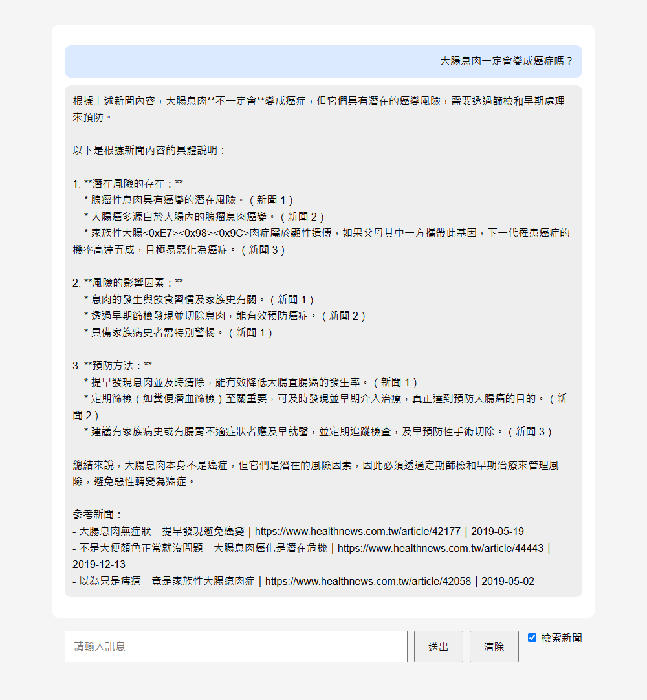
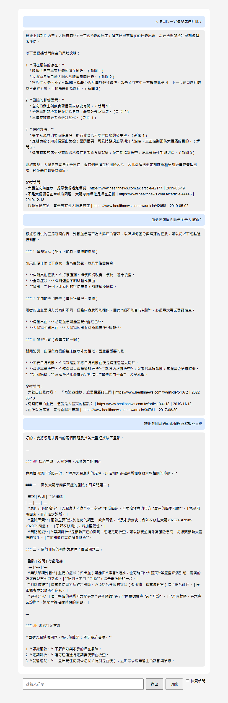

# 健康諮詢小幫手（RAG）

以 RAG（檢索增強生成）建立的健康諮詢問答網頁。系統先從新聞資料庫檢索相關新聞，再由地端模型根據新聞回答，並在回答後面列出參考新聞。

## 資料來源
- [健康醫療網](https://www.healthnews.com.tw/) 新聞分類（網路爬蟲，主題：大腸癌相關新聞，共 248 篇）

## 資料表欄位
資料庫：`news.db`（SQLite），資料表 `news`。

| 欄位 | 說明 | 作業對應 |
|---|---|---|
| `id` | 流水號 | 流水號 |
| `title` | 新聞標題 | 新聞標題 |
| `link` | 新聞連結 | 新聞連結 |
| `content` | 文章全文 | 文章全文 |
| `summary` | 文章摘要（地端模型產生） | 文章摘要 |
| `date` | 新聞發布日期 | 文章新增時間（回答中顯示此欄位） |
| `created_at` | 資料寫入資料庫的時間 | （備查） |
| `reporter`、`img_path` | 記者、圖片網址 | （額外欄位） |

> 回答後面附上的「時間」使用 `date`（新聞發布日期）。`created_at` 是寫入資料庫的時間，248 篇幾乎同一天，對讀者沒有意義。

## 使用模型
| 用途 | 模型 | 執行方式 |
|---|---|---|
| 產生文章摘要 | `gemma4:e4b`（見 `crawl_data.py`） | 地端，Ollama |
| 問答 | `gemma4:e2b`（見 `app.py`） | 地端，Ollama |
| 向量模型 | `BAAI/bge-m3`（1024 維） | 地端，sentence-transformers；首次執行自動下載約 2.3GB |

## 安裝套件
環境：Python 3.11.9、Windows。

```
pip install -r requirements.txt
```

| 套件 | 版本 |
|---|---|
| flask | 3.1.3 |
| ollama | 0.6.3 |
| faiss-cpu | 1.15.1 |
| sentence-transformers | 6.1.0 |
| numpy | 2.4.6 |
| torch | 2.12.0 |
| requests | 2.34.2 |
| beautifulsoup4 | 4.14.3 |
| lxml | 6.1.1 |

另外要安裝 [Ollama](https://ollama.com/)，並下載問答模型：

```
ollama pull gemma4:e2b
```

## 系統流程
**階段 A：事前準備（只做一次）**
1. `crawl_data.py`：爬蟲取得新聞，存成 JSON。
2. `crawl_data.py`：標題 + 全文 → 地端模型產生摘要。
3. `init_db.py`：寫入 `news.db`。
4. `make_index.py`：「標題 + 摘要」→ BGE-M3 → 向量，用 FAISS 建成 `vector.index`（`IndexIDMap` 讓每個向量記住資料庫 `id`）。

**階段 B：使用者發問**
1. 網頁輸入問題，可勾選「檢索新聞」。
2. 有勾選：`query.py` 的 `search()` 把問題轉成向量，在 `vector.index` 找最相似的 3 篇，用 `id` 回 `news.db` 取資料。
3. `app.py` 把新聞與問題組成 prompt，連同對話歷史交給 gemma 回答（串流輸出）。
4. 回答後面條列「標題｜連結｜時間」。
5. 沒有勾選：不檢索，只靠對話歷史回答（例如「整理剛剛的問題」）。

設計說明：
- 對話歷史只存原始問題與回答，不存檢索到的新聞，避免歷史越來越長。
- 向量用摘要（約 300 字）建立，長度遠低於 BGE-M3 上限，且一篇新聞只談單一主題，因此不做切塊（chunking）。

## 執行方法
```
# 階段 A（專案已附 news.db 與 vector.index，可跳過）
python crawl_data.py      # 爬蟲 + 摘要，需要 Ollama 與 gemma4:e4b
python init_db.py         # 建立 news.db
python make_index.py      # 建立 vector.index（重建前請先刪除舊的 vector.index）

# 階段 B：啟動問答網頁
python app.py
```
瀏覽器開啟 http://127.0.0.1:5000 。啟動時要載入 BGE-M3，需等數秒。

## 問答示範
以下為實際執行結果。對話歷史先按「清除」，前兩題勾選「檢索新聞」，第三題不勾選。

### 問題 1（檢索）：大腸息肉一定會變成癌症嗎？
> 根據提供的新聞內容，大腸息肉**不一定**會變成癌症。
>
> - **潛在風險：** 腺瘤性息肉具有癌變的潛在風險。
> - **惡化可能性：** 如果不處理，息肉可能累積變大或惡性轉變為大腸癌。
> - **預防性治療：** 透過早期發現並切除息肉，可以有效降低大腸直腸癌的發生率和死亡率。
> - **高風險族群：** 某些情況（如家族性大腸瘜肉症）的息肉極易惡化為癌症。
>
> 參考新聞：
> - 大腸息肉無症狀　提早發現避免癌變｜https://www.healthnews.com.tw/article/42177｜2019-05-19
> - 不是大便顏色正常就沒問題　大腸息肉癌化是潛在危機｜https://www.healthnews.com.tw/article/44443｜2019-12-13
> - 以為只是痔瘡　竟是家族性大腸瘜肉症｜https://www.healthnews.com.tw/article/42058｜2019-05-02

### 問題 2（檢索）：血便要怎麼判斷是不是大腸癌？
> 血便不能僅憑出血本身判斷，要綜合觀察症狀與伴隨體徵，並尋求專業檢查。
> 1. 警覺的症狀：持續腹痛、排便習慣改變、便秘、裡急後重、體重不明減輕或貧血。
> 2. 區分痔瘡與大腸癌：早期大腸癌可能表現得像痔瘡，不應自行判斷。
> 3. 應採取的行動：尋求醫師肛診與內視鏡檢查；符合年齡者定期做糞便潛血檢查。
>
> 參考新聞：
> - 大號出血是痔瘡？　「有這些症狀」恐是腸癌找上門｜https://www.healthnews.com.tw/article/54072｜2022-06-13
> - 時有時無的血便　這就是大腸癌的警訊？｜https://www.healthnews.com.tw/article/44118｜2019-11-13
> - 血便以為痔瘡　竟是直腸癌末期｜https://www.healthnews.com.tw/article/34761｜2017-08-30

（以上為節錄，完整回答較長。）

### 問題 3（不檢索）：請把我剛剛問的兩個問題整理成重點
> **重點一：大腸息肉與癌症的關係** — 大腸息肉不一定會變成癌症，但具有潛在風險；早期發現並切除可降低大腸直腸癌發生率；應定期做大腸鏡檢查。
>
> **重點二：血便與大腸癌的判斷** — 血便本身不能作為診斷依據；若伴隨腹痛、體重不明減輕、排便習慣改變等症狀，需高度警覺；應就醫做肛診、內視鏡與糞便潛血檢查。
>
> 總結：不要自行診斷；警惕伴隨的全身症狀；定期接受篩檢。

這一題不需要檢索，答案來自對話歷史，所以取消勾選。

### 檢索前後對照
同一題「台灣有哪兩家醫院合作開發大腸鏡 AI 瘜肉偵測系統？他們用了多少張影像訓練？」（先清除歷史）：
- 勾選：回答「臺大醫院、國泰綜合醫院，超過 40 萬張影像」。
- 不勾選：回答無法提供具體資訊。

## 成果
模型每次回答的措辭略有不同，上方文字與下列截圖是不同次執行的結果。

**問題 1（勾選檢索）**



**問題 2（勾選檢索）、問題 3（不勾選，整理前兩題）**



## 已知限制
- 22 / 248 篇摘要含有 `<0xE7><0x98><0x9C>` 這類亂碼（罕見字「瘜」等被模型輸出成位元組）。檢索不受影響，但回答偶爾會原樣抄出亂碼。
- 摘要由模型改寫，可能遺漏細節，只靠摘要比對時，這些細節搜不到。
- 回答由地端小模型產生，「只根據新聞回答」的規則只能降低、不能消除亂編的風險，請以附上的參考新聞為準。
- 連結在網頁上以純文字顯示，無法直接點擊。

## 學習歷程
### 1. 理解 RAG 與向量搜尋
- 用 SQL `LIKE` 做關鍵字搜尋：整句問題「有人用 AI 來偵測大腸瘜肉嗎？」找到 0 筆；口語「大便有血」只找到 2 篇，而新聞用的「血便」有 72 篇。關鍵字搜尋比對字面，用字不同就找不到。
- 改用 BGE-M3 向量搜尋，同一句問題的前 3 名全部是 AI 偵測息肉的新聞，連標題寫「息肉」（問題寫「瘜肉」）的也找得到。
- 區分兩個模型的分工：BGE-M3 負責「找」（文字 → 向量），gemma 負責「說」（讀完新聞寫回答）。
- 向量是推論（inference），不是訓練；BGE-M3 的參數不會改變，改變的只有 `vector.index`。

### 2. 建立索引與檢索函式
- 作業要求用「文章摘要」轉向量，因此修改 `make_index.py`，由「標題 + 全文」改成「標題 + 摘要」。
- `IndexIDMap` 讓每個向量記住資料庫 `id`，檢索後才能回 `news.db` 查標題、連結、日期。
- `make_index.py` 在 `vector.index` 已存在時會把新向量「加進去」而不是取代，重跑會讓同一篇出現兩次；重建前要先刪除舊檔。
- 把 `query.py` 改成 `search(question, k=3)`，回傳「字典組成的清單」；BGE-M3 與索引放在函式外面，只在啟動時載入一次。

### 3. 網頁與多輪對話
- 前端 checkbox 有三個不同的名字：HTML 的 `id`、JavaScript 變數、送給後端的欄位 `use_rag`，三者各自對應，不必相同。
- 後端 `use_rag` 為真才呼叫 `search()`；沒勾選時只靠對話歷史，所以「整理剛剛問的問題」要取消勾選。
- 送給 gemma 的是「規則 + 新聞 + 問題」，存進歷史的只有原問題，避免歷史被舊新聞塞滿。
- 回答後面的「參考新聞」在 `for` 迴圈外面送出，只送一次。

### 4. 遇到的問題與解法
| 問題 | 原因 | 解法 |
|---|---|---|
| 網頁送出問題後沒有回答 | 範例 `client.chat(host=...)` 在 `ollama==0.6.3` 不接受 `host` 參數，噴 `TypeError` | 刪掉該參數（主機位址已在 `Client(host=...)` 設定），並在 README 寫死 `ollama` 版本 |
| `SyntaxError: invalid character '˙'` | 中文輸入法在程式碼裡打進了注音符號 | 刪除該字元；寫程式時輸入法切英文 |
| 來源被重複送出 599 次 | `if sources:` 縮排在 `for` 迴圈裡，每收到一小段就送一次 | 縮排改成與 `for` 對齊，迴圈結束後只送一次 |
| 不勾選也答得出新聞細節 | 對話歷史裡有先前勾選時的回答，gemma 從歷史抄 | 對照實驗前先按「清除」 |
| 摘要含 `<0xE7><0x98><0x9C>` | 罕見字「瘜」被模型輸出成位元組，共 22 / 248 篇 | 未修正，列入已知限制 |

### 5. 如何確認系統真的用到 RAG
光看回答很難分辨：「AI 能輔助偵測息肉」這類常識，gemma 不需要新聞也答得出來。做法是問只有新聞才有的細節（「哪兩家醫院合作開發？用了多少張影像？」），並先清除歷史再對照：勾選答出「臺大醫院、國泰綜合醫院、超過 40 萬張」，不勾選則答不出來。

### 6. 心得
RAG 的回答仍然由模型生成，檢索只負責提供資料。prompt 規則只能降低模型亂編的機率，所以回答後面附上參考新聞，讓使用者能自己核對。
